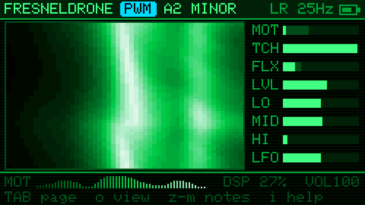
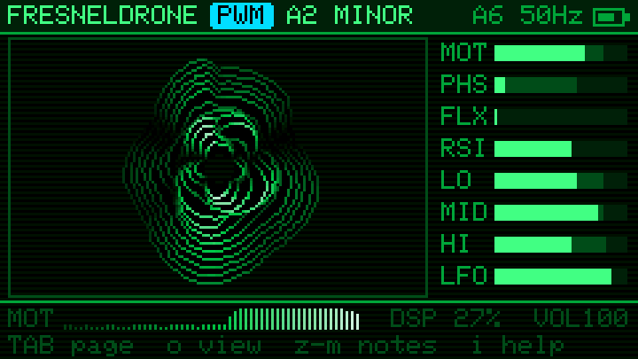
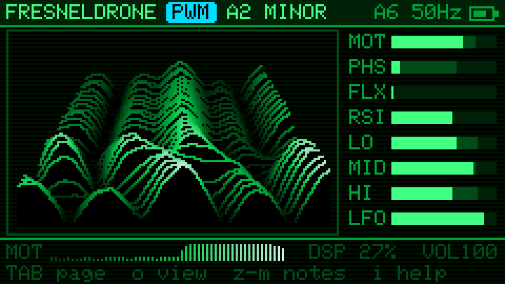

# FRESNELDRONE

A drone synth for the M5Stack Cardputer ADV that the room plays. It reads WiFi Channel State Information (CSI): when people move, the multipath changes, and the 52-subcarrier fingerprint drives seven drone engines and an FX chain through an 8-slot mod matrix.

Without WiFi, or to cover a whole flat through walls, **LoRa mode** reads a LoRa link instead: a Heltec board sends beacons, the Cap LoRa-1262 on the Cardputer measures how people moving change them (see [LoRa mode](#lora-mode)).

How to play it: [manual.md](manual.md).

## Screens

Rendered by the firmware's own drawing code from a simulated room, in which someone walks in 1.7 s before the shot (`test/screens.cpp`).

| | |
|---|---|
|  |  |
| **Waterfall**: the 52 subcarriers over time (newest on top): still stripes below, a person walking in above. Mod source meters on the right. | **Bars**: the live subcarrier shape with peak ghosts; amber ticks mark the calibrated empty room. |
|  |  |
| **Params**: set values as bars, white ticks where the room has pushed them. Greyed params belong to effects that are off. | **Matrix**: 8 routings of source → param with depth; the source meters are live. |
|  |  |
| **Options** (`` ` ``) | **Help** (`i`) |
|  |  |
| **Calibrate** (`e`): 5 s to leave the room… | …then the empty room is captured. Any key cancels. |
|  |  |
| **LoRa mode**: the waterfall becomes the link's wobble spectrum (0.03 Hz left, 1.2 Hz right, log-spaced): someone moving about lights it up. TCH and LVL take PHS's and RSI's places. | **RADIAL** waterfall (`o`): newest in the middle, history rippling out. |
|  | |
| **3D** waterfall (`o` again): newest ridge in front. | |

## Build / flash

Two boards, one project ([PlatformIO](https://platformio.org/install/cli)). Plug one in over USB-C, then:

```sh
pio run -t upload            # Cardputer ADV
pio run -e heltec -t upload  # Heltec WiFi LoRa 32 V3 (only needed for LoRa mode)
```

With both plugged in, **always add `--upload-port`**: PlatformIO's board file gives the Heltec the same USB ID as the Cardputer, so auto-detect can flash the Heltec's firmware onto the Cardputer. `pio device list` shows the ports: the Cardputer is the ESP32-S3's own USB (`303A:1001`, e.g. `/dev/cu.usbmodem…`, `/dev/ttyACM0`), the Heltec its CP2102 (`10C4:EA60`, e.g. `/dev/cu.usbserial-…`, `/dev/ttyUSB0`).

```sh
pio run -t upload --upload-port /dev/cu.usbmodem1443101
pio run -e heltec -t upload --upload-port /dev/cu.usbserial-0001
```

`pio device monitor -p <port>` shows what each prints: crash reasons and free heap at boot, and in LoRa mode the link once a second on both boards.

- **Cardputer:** if it doesn't show up, hold G0 while plugging in USB.
- **Heltec:** screw the 868 MHz antenna on first: transmitting without one can damage the radio. If the upload can't connect, hold PRG, tap RST, let go of PRG. This replaces whatever was on it (Meshtastic, say); [flasher.meshtastic.org](https://flasher.meshtastic.org) puts that back.

Each build also writes a merged image (bootloader, partitions, boot_app0, app): `fresneldrone.bin` for the Cardputer, `fresneldrone-heltec.bin` for the Heltec. Prebuilt ones are on the [releases page](https://github.com/vdo/fresneldrone/releases/latest). To flash an image without PlatformIO, open [ESPConnect](https://thelastoutpostworkshop.github.io/ESPConnect/), connect, go to Flash Firmware, load the `.bin`, set offset `0x0`, and flash.

The boot screen shows the firmware version from `git describe`: `v0.3` on a release, `v0.3-2-gabc1234` between releases (`-dirty` with uncommitted changes).

## Network modes

The network screen opens on first boot, and later from `` ` `` → NETWORK. Your choice is saved and resumed at the next boot.

| Mode | How | Rate |
|---|---|---|
| AUTO | Hops channels 1–13 for ~3 s, counts CSI frames per transmitter, and locks onto the busiest. Re-surveys after 8 s of silence. No password. | whatever's busiest nearby |
| JOIN | Associates, then pings the router 50×/s so it keeps answering. Needs the password. | steadiest, ~50 Hz+ |
| LISTEN | Promiscuous on one network's channel, filtered to that router. No password. | depends on the router's traffic; beacons sent at 1 Mbps yield no CSI |
| LORA | No WiFi: measures a Heltec's packets with the Cap LoRa-1262 (see below). | 25 Hz |

The header shows the mode letter, channel and CSI rate, e.g. `A6 48Hz` (`LR 25Hz` in LoRa mode: beacons per second), then the battery. The drone stays silent until you press `Space` (or a note key). Started before CSI arrives, it hums on the LFO.

## Audio out

Nothing sounds until `Space` (play). On the ADV, plugging headphones into the jack switches the speaker amp off in hardware. Neither the amp enable nor the headphone-detect line reaches a GPIO, so software can only mute both outputs together: `` ` `` → AUDIO OUT.

## Keys

| Key | Action |
|---|---|
| `Space` | play / stop on any page (fades, resumes where it left off) |
| `z x c v b n m` | white notes C D E F G A B: set the drone's root in the current octave (it glides there; a note while stopped starts playing) |
| `s d g h j` | black notes C# D# F# G# A# |
| `Shift` + note | the note an octave up; the next plain note drops back |
| `t` | interval of voice 2: fifth → fourth → octave → third (minor or major, from the scale) |
| `a` | tap: drift, the root wanders among nearby scale notes every 20–60 s, faster when the room moves (`~` after the scale). Hold 3 s: **autopilot** (header shows `AUTO`): drift, params easing toward new random targets every 1–2 min, a matrix slot re-rolled every 20–45 s, and every 3–6 min a new section faded in (scale; often engine, voices, interval, LFO shape, key). Pitch, noise and level stay put. Any `a` press stops it |
| `f` | freeze: the room's mods hold where they are (footer shows `FRZ`); the LFO keeps moving |
| hold `q` | fade the drone out slowly; release to swell back |
| `u` | undo: back through randomize, preset loads, notes, engine, voices, interval and effect switches (8 steps) |
| `Fn` + `1`–`7` | effect on/off from any page: drive, crush, ring, chorus, delay, reverb, shimmer |
| `Tab` | page: Waterfall → Bars → Params → Matrix |
| `o` | waterfall view: XY → RADIAL → 3D (remembered) |
| `1`–`7` | engine: PWM, SAW (supersaw), FM (bell), ORG (subcarrier additive organ), WAVE (wavetable), VOICE (formant choir), NOISE (dust, wind, surf, static, metal) |
| `p` | voices: 1 (root), 2 (+ interval, a fifth by default), 3 (+ sub) |
| `r` | tap: randomize params in drone-friendly ranges (pitch, noise and level stay put, shimmer only now and then). Hold 3 s (the footer counts down): randomize only the mod matrix (sources, destinations, depths) and the LFO shape, then the Matrix page opens |
| `[` `]` | root note down / up a semitone |
| `9` `0` | octave down / up |
| `k` | cycle scale (CSI pitch drift is quantised to it) |
| `e` | calibrate an empty-room baseline: 5 s countdown to leave the room, then ~3 s capture (any key cancels); LO/MID/HI then measure deviation from it |
| `w` / `l` then `1`–`8` | save (write) / load preset to `/fresneldrone/presetN.json` on SD |
| `-` `=` | volume |
| `` ` `` | options: audio out, volume, mod profile (sharp, normal, smooth, slow), LFO shape (sine, triangle, saw, square, S&H, drift) and rate, theme (green, yellow, red, blue, B&W), network, calibrate |
| `i` | key help overlay |
| `;` `.` | up / down (Params, Matrix) |
| `,` `/` | adjust value (Params, Matrix) |
| `Enter` | on Params, toggles the selected param's FX; on Matrix, moves to the next column (src → dest → depth); elsewhere play / stop |
| `Del` | Matrix: clear slot |

## LoRa mode

For when there's no WiFi to read, or to sense the whole flat through walls. Needs the [Cap LoRa-1262](https://docs.m5stack.com/en/cap/Cap_LoRa-1262) on the Cardputer and a [Heltec WiFi LoRa 32 V3](https://wiki.heltec.org/docs/devices/open-source-hardware/esp32-series/lora-32/wifi-lora-32-v3/Pin-diagram-guidance) (868 MHz version) running `src/heltec/beacon.cpp`; both antennas on. Power the Heltec anywhere (USB charger or its battery plug), then `` ` `` → NETWORK → LORA.

The Heltec sends 25 five-byte LoRa beacons a second (SF6, 250 kHz wide: 869.725–869.975 MHz) at +5 dBm. That's inside EU 869.7–870 MHz, which allows 5 mW ERP with no duty-cycle limit; each beacon is ~11 ms on air, ~30% of the time. Its LED blinks slowly while it sends. The Cardputer measures the level of each beacon, draws a straight line between consecutive ones into 50 Hz frames (40 ms behind), and refills the same eight slots, so the matrix and presets carry over. Four times a second it answers in the gap after a beacon (same frequency and power) with how well it hears the Heltec; both ends share the packet layout in `src/link.h`. The Heltec's OLED shows the link:

```
FRESNELDRONE 869.85MHz
CARDPUTER HEARS
-62dBm         25/s        level and rate of the beacons the Cardputer reads (WAITING / LOST until it answers)
[##########          ]     signal: -110 to -40 dBm
BACK -58dBm  4/s           the Cardputer's answers, as heard here
TX 25/s  AIR 30%           beacons sent per second, share of time on air
BAT 3.95V 31C UP 1:23:45   battery (-- without one), chip temperature, uptime
```

A task woken by the radio reads each one as it lands. Measured across a flat, through walls: every beacon at −74 to −82 dBm. SF6's receive limit is around −118 dBm, so there's room for several more walls, or a few hundred metres to a kilometre outdoors with line of sight (estimated). The serial log shows each beacon's level and SNR; an SNR near 0 dB is the edge of range. There's no shape and no phase on this link, so the slots mean something a little different:

| Slot | LoRa | What moves it |
|---|---|---|
| MOT | short vs long average of the level | anyone moving where the signal reaches, through walls |
| PHS → **TCH** | the Heltec's touch pins GPIO2–7: a fingertip on a bare header pin; a wire or foil on one senses a hand a few cm away | you, playing it |
| FLX | packet-to-packet change of the level | walking, fast movement |
| RSI → **LVL** | the level (−100 to −40 dBm); after `e`, its distance from the empty flat's level (6 dB = full) | someone being there, doors, standing in the path |
| LO / MID / HI | thirds of the wobble spectrum: 0.03–0.1 Hz, 0.1–0.35 Hz, 0.35–1.2 Hz | slow tides (10–30 s swells) / someone moving about / gestures, walking |

The waterfall and the ORG engine's partials follow the wobble spectrum instead of the subcarriers: 52 bandpass filters, log-spaced from 0.03 to 1.2 Hz, quicker columns boosted (×f^0.4) since motion has less energy at quick rates. Tuned on a recording of someone moving across a flat: it centres on MID and the middle of the waterfall, and leaves out the flicker of LoRa's 1 dB level steps above ~1 Hz. The quickest columns react within ~1 s, the slowest over tens of seconds; MOT and FLX react at once. The MOD PROFILE (options) adds its own glide on top: NORMAL or SHARP feel immediate. Place the two boards so people pass between them; a body in the direct path makes the biggest change.

## Mod sources (from CSI)

| | |
|---|---|
| MOT | motion: short vs long average of the subcarrier shape |
| PHS | phase variance |
| FLX | frame-to-frame flux (fast, jittery) |
| RSI | RSSI |
| LO / MID / HI | deviation per subcarrier third (from the baseline after `e`) |
| LFO | internal, bipolar, rate = LFO param |

Destinations: PITCH CUTOFF RESO TIMBRE SPREAD NOISE LFO LEVEL DRIVE CRUSH RING CHORUS D.TIME D.FB REVERB SHIMMR.
TIMBRE is per engine: pulse width, supersaw side level, FM index, how strongly the CSI spectrum shapes the organ partials, wavetable position (sine → warm → triangle → saw → square → "ah" → nasal → glass), vowel (a e i o u), or the kind of noise (dust → wind → surf → static → metal, morphing in between; all unpitched but metal).
DRIVE is analog-style: biased like a tube for even harmonics, and darker the harder it is pushed.
The LFO shape is saved with presets; the theme is saved on the device.

## Tuning on hardware

- `MOD_PROFILES` in `src/dsp.h`: glide times (seconds) for CSI modulation and scale steps behind the SHARP / NORMAL / SMOOTH / SLOW option.
- `kMinRange` in `src/csi.h`: raise it if a still room still wiggles the mods, lower it if motion reads weakly.
- LoRa mode, in `src/csi.h`: `kLoraFloor` (dB of wobble that can't read as full scale: raise it if a still link twitches), `kLvlRange` (dB from the empty flat for full LVL), `kTouchMin` (smallest touch that can read as full TCH), `kWobLo` / `kWobHi` (the wobble spectrum's span) and the `0.4` tilt in `level()`. In `src/link.h`: `LORA_PERIOD_MS` and `LORA_POWER` (keep it within 5 mW ERP for your antenna). On the Heltec (`src/heltec/beacon.cpp`): `kTouchNoise`.
- The footer's `DSP %` shows synth load on core 1, which audio has to itself (WiFi and the UI share core 0). Keep it well under 100.
- After a crash, the splash screen says what kind it was: panic, watchdog or brownout.
- Free heap is printed on USB serial at boot (`pio device monitor`).

## Check

```sh
c++ -std=c++17 -O2 -Isrc test/host_test.cpp -o /tmp/fresneldrone_test && /tmp/fresneldrone_test /tmp
```

To re-render the screenshots after a UI change:

```sh
c++ -std=c++17 -O2 -Isrc -I.pio/libdeps/fresneldrone/M5GFX/src/lgfx/Fonts test/screens.cpp -lz -o /tmp/screens && /tmp/screens docs
```

The host test exercises the scale quantiser, preset JSON (including hostile input), CSI motion response, the LoRa link's sources, and renders every engine. With a directory argument it also writes WAVs there.

## License

MIT, see [LICENSE](LICENSE).
