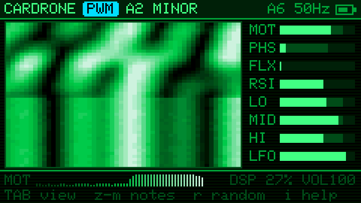
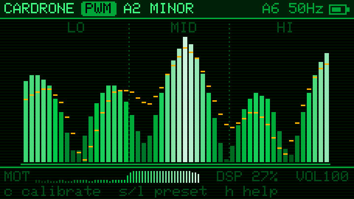
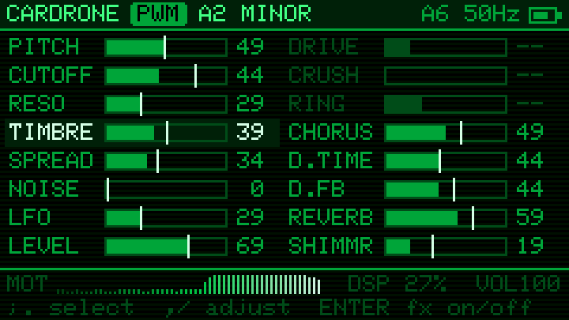
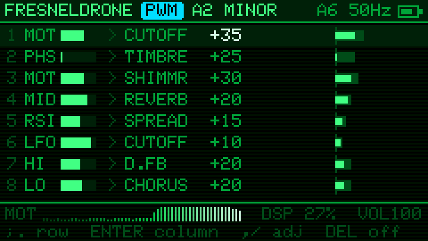
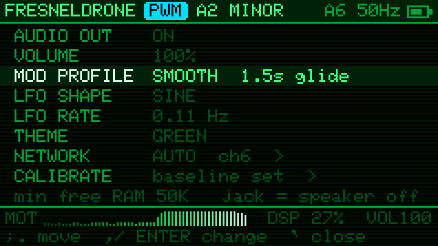
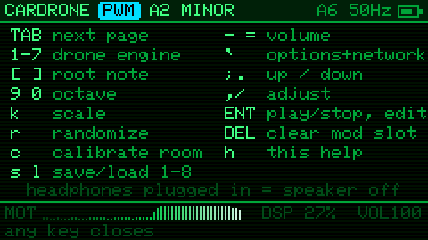
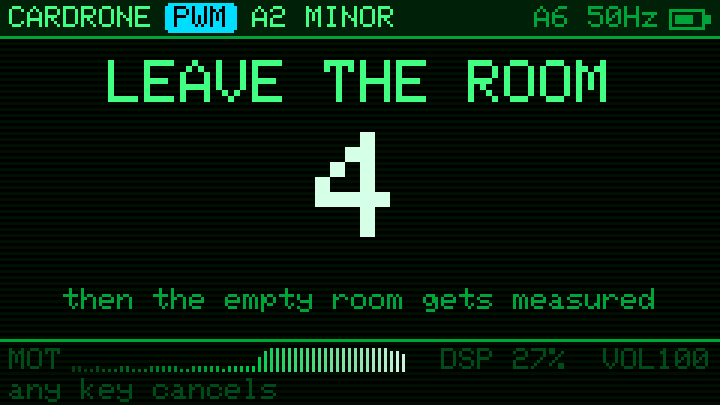
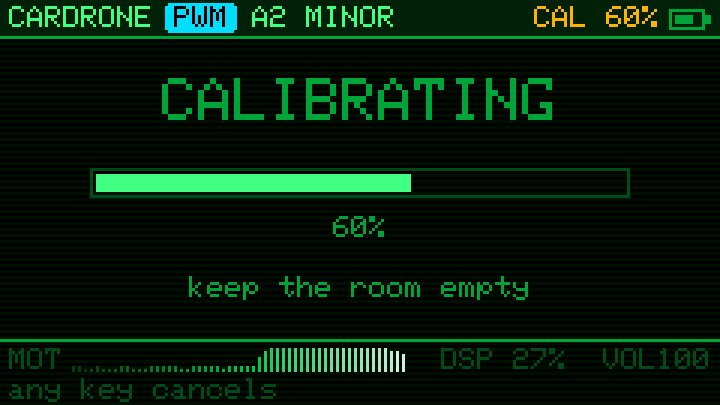

# CARDRONE

A drone synth for the M5Stack Cardputer ADV that the room plays. It reads WiFi Channel State Information (CSI): when people move, the multipath changes, and the 52-subcarrier fingerprint drives seven drone engines and an FX chain through an 8-slot mod matrix.

How to play it: [manual.md](manual.md).

## Screens

Rendered by the firmware's own drawing code from a simulated room, in which someone walks in 1.7 s before the shot (`test/screens.cpp`).

| | |
|---|---|
|  |  |
| **Waterfall**: the 52 subcarriers over time (newest on top): still stripes below, a person walking in above. Mod source meters on the right. | **Bars**: the live subcarrier shape with peak ghosts; amber ticks mark the calibrated empty room. |
|  |  |
| **Params**: set values as bars, white ticks where the room has pushed them. Greyed params belong to effects that are off. | **Matrix**: 8 routings of source → param with depth; the source meters are live. |
|  |  |
| **Options** (`` ` ``) | **Help** (`i`) |
|  |  |
| **Calibrate** (`e`): 5 s to leave the room… | …then the empty room is captured. Any key cancels. |

## Build / flash

```sh
pio run -t upload
```

The boot screen shows the firmware version from `git describe`: `v0.3` on a release, `v0.3-2-gabc1234` between releases (`-dirty` with uncommitted changes).

Every build also writes `cardrone.bin`, a merged image of bootloader, partitions, boot_app0 and app; a prebuilt one is on the [releases page](https://github.com/vdo/cardrone/releases/latest). To flash it without PlatformIO, open [ESPConnect](https://thelastoutpostworkshop.github.io/ESPConnect/), connect, go to Flash Firmware, load `cardrone.bin`, set offset `0x0`, and flash. If the device doesn't show up, hold G0 while plugging in USB.

## Network modes

The network screen opens on first boot, and later from `` ` `` → NETWORK. Your choice is saved and resumed at the next boot.

| Mode | How | Rate |
|---|---|---|
| AUTO | Hops channels 1–13 for ~3 s, counts CSI frames per transmitter, and locks onto the busiest. Re-surveys after 8 s of silence. No password. | whatever's busiest nearby |
| JOIN | Associates, then pings the router 50×/s so it keeps answering. Needs the password. | steadiest, ~50 Hz+ |
| LISTEN | Promiscuous on one network's channel, filtered to that router. No password. | depends on the router's traffic; beacons sent at 1 Mbps yield no CSI |

The header shows the mode letter, channel and CSI rate, e.g. `A6 48Hz`, then the battery. The drone stays silent until you press `Space` (or a note key). Started before CSI arrives, it hums on the LFO.

## Audio out

Nothing sounds until `Space` (play). On the ADV, plugging headphones into the jack switches the speaker amp off in hardware. Neither the amp enable nor the headphone-detect line reaches a GPIO, so software can only mute both outputs together: `` ` `` → AUDIO OUT.

## Keys

| Key | Action |
|---|---|
| `Space` | play / stop on any page (fades, resumes where it left off) |
| `z x c v b n m` | white notes C D E F G A B: set the drone's root in the current octave (it glides there; a note while stopped starts playing) |
| `s d g h j` | black notes C# D# F# G# A# |
| `Shift` + note | the note an octave up; the next plain note drops back |
| `t` | interval of voice 2: fifth → fourth → octave → third (minor or major, from the scale) |
| `a` | tap: drift, the root wanders among nearby scale notes every 20–60 s, faster when the room moves (`~` after the scale). Hold 3 s: **autopilot** (header shows `AUTO`): drift, params easing toward new random targets every 1–2 min, a matrix slot re-rolled every 20–45 s, and every 3–6 min a new section faded in (scale; often engine, voices, interval, LFO shape, key). Pitch, noise and level stay put. Any `a` press stops it |
| `f` | freeze: the room's mods hold where they are (footer shows `FRZ`); the LFO keeps moving |
| hold `q` | fade the drone out slowly; release to swell back |
| `u` | undo: back through randomize, preset loads, notes, engine, voices, interval and effect switches (8 steps) |
| `Fn` + `1`–`7` | effect on/off from any page: drive, crush, ring, chorus, delay, reverb, shimmer |
| `Tab` | page: Waterfall → Bars → Params → Matrix |
| `1`–`7` | engine: PWM, SAW (supersaw), FM (bell), ORG (subcarrier additive organ), WAVE (wavetable), VOICE (formant choir), NOISE (dust, wind, surf, static, metal) |
| `p` | voices: 1 (root), 2 (+ interval, a fifth by default), 3 (+ sub) |
| `r` | tap: randomize params in drone-friendly ranges (pitch, noise and level stay put, shimmer only now and then). Hold 3 s (the footer counts down): randomize only the mod matrix (sources, destinations, depths) and the LFO shape, then the Matrix page opens |
| `[` `]` | root note down / up a semitone |
| `9` `0` | octave down / up |
| `k` | cycle scale (CSI pitch drift is quantised to it) |
| `e` | calibrate an empty-room baseline: 5 s countdown to leave the room, then ~3 s capture (any key cancels); LO/MID/HI then measure deviation from it |
| `w` / `l` then `1`–`8` | save (write) / load preset to `/cardrone/presetN.json` on SD |
| `-` `=` | volume |
| `` ` `` | options: audio out, volume, mod profile (sharp, normal, smooth, slow), LFO shape (sine, triangle, saw, square, S&H, drift) and rate, theme (green, yellow, red, blue, B&W), network, calibrate |
| `i` | key help overlay |
| `;` `.` | up / down (Params, Matrix) |
| `,` `/` | adjust value (Params, Matrix) |
| `Enter` | on Params, toggles the selected param's FX; on Matrix, moves to the next column (src → dest → depth); elsewhere play / stop |
| `Del` | Matrix: clear slot |

## Mod sources (from CSI)

| | |
|---|---|
| MOT | motion: short vs long average of the subcarrier shape |
| PHS | phase variance |
| FLX | frame-to-frame flux (fast, jittery) |
| RSI | RSSI |
| LO / MID / HI | deviation per subcarrier third (from the baseline after `e`) |
| LFO | internal, bipolar, rate = LFO param |

Destinations: PITCH CUTOFF RESO TIMBRE SPREAD NOISE LFO LEVEL DRIVE CRUSH RING CHORUS D.TIME D.FB REVERB SHIMMR.
TIMBRE is per engine: pulse width, supersaw side level, FM index, how strongly the CSI spectrum shapes the organ partials, wavetable position (sine → warm → triangle → saw → square → "ah" → nasal → glass), vowel (a e i o u), or the kind of noise (dust → wind → surf → static → metal, morphing in between; all unpitched but metal).
DRIVE is analog-style: biased like a tube for even harmonics, and darker the harder it is pushed.
The LFO shape is saved with presets; the theme is saved on the device.

## Tuning on hardware

- `MOD_PROFILES` in `src/dsp.h`: glide times (seconds) for CSI modulation and scale steps behind the SHARP / NORMAL / SMOOTH / SLOW option.
- `kMinRange` in `src/csi.h`: raise it if a still room still wiggles the mods, lower it if motion reads weakly.
- The footer's `DSP %` shows synth load on core 1, which audio has to itself (WiFi and the UI share core 0). Keep it well under 100.
- After a crash, the splash screen says what kind it was: panic, watchdog or brownout.
- Free heap is printed on USB serial after WiFi comes up.

## Check

```sh
c++ -std=c++17 -O2 -Isrc test/host_test.cpp -o /tmp/cardrone_test && /tmp/cardrone_test /tmp
```

To re-render the screenshots after a UI change:

```sh
c++ -std=c++17 -O2 -Isrc -I.pio/libdeps/cardrone/M5GFX/src/lgfx/Fonts test/screens.cpp -lz -o /tmp/screens && /tmp/screens docs
```

The host test exercises the scale quantiser, preset JSON (including hostile input), CSI motion response, and renders every engine. With a directory argument it also writes WAVs there.

## License

MIT, see [LICENSE](LICENSE).
